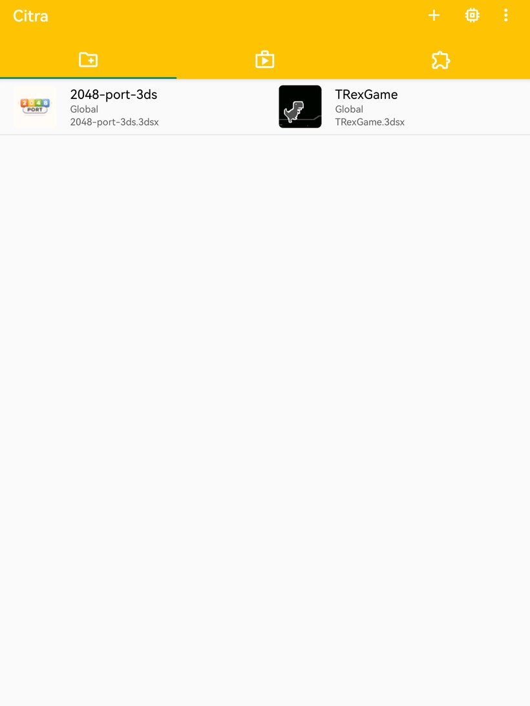
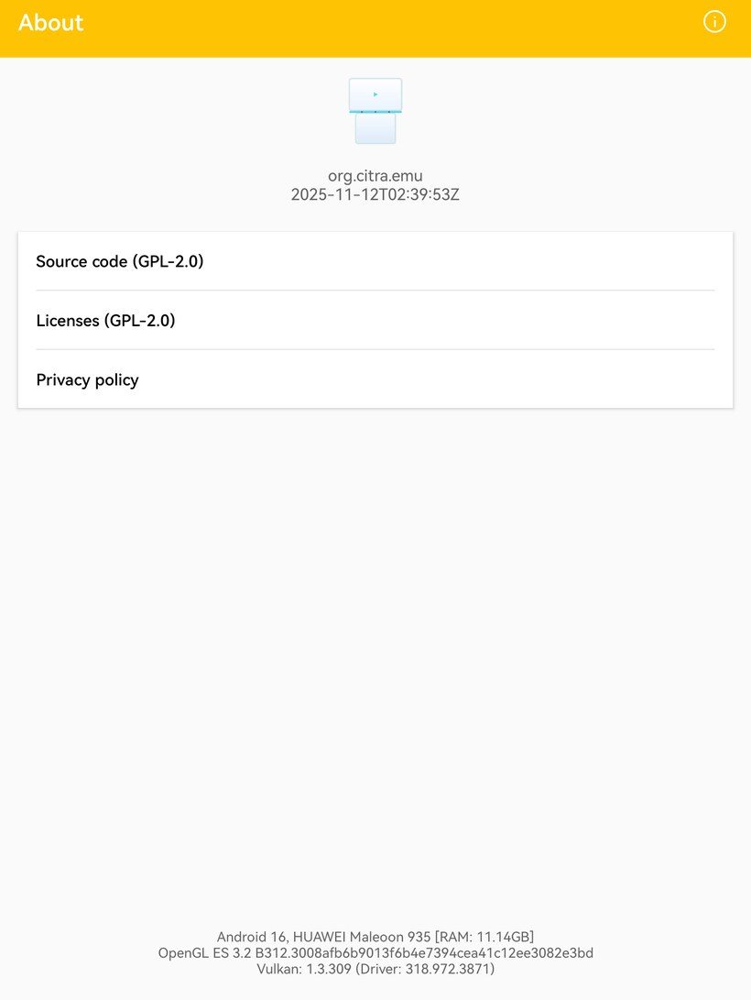

# Ctria Hope

**A foldable-first build of the Citra 3DS emulator, made for the HUAWEI Pura X Max.**

<p align="center">
  
  
</p>

Ctria Hope turns the inner display of a foldable phone into a handheld 3DS: the top
screen is rendered in the upper half at the exact 5:3 aspect ratio the console uses,
the bottom screen plus a full touch control set sits in the lower half, and the whole
layout is wrapped in programmatically rendered panel artwork so the phone reads as a
console rather than as a phone showing an emulator.

The emulation core is untouched. This is a **layout, ergonomics and skinning** project
on top of [Citra MMJ](https://github.com/weihuoya/citra): nothing here changes how
3DS software is executed, and no ROMs are included or downloaded.

| | |
|---|---|
| App version | 1.4.0 (versionCode 4040) |
| Package | `org.citra.emu` |
| Base | Citra MMJ `3eb22034a` (GPL-2.0) |
| minSdk / targetSdk | 24 / 34 |
| Verified on | HUAWEI Pura X Max (`HOP-LX9`), EMUI 16 / AOSP 16 |
| License | GPL-2.0-or-later |

---

## Why this exists

Stock Citra MMJ on a 1828×2584 foldable gets three things wrong:

1. **The 3DS is not a full-screen device.** It has two screens, one of them a
   resistive touchscreen. Stretched across a 1828 px tall display, the top screen is
   either letterboxed into a thin strip or blown up past any sensible pixel density,
   and the touchscreen ends up where your thumb never goes.
2. **The hinge is a hard edge, not a soft one.** Content has to stop *above* the
   crease, otherwise the fold line cuts through the middle of the picture.
3. **Touch controls land on top of the game.** With a default layout the overlay
   covers the bottom screen exactly where the game expects taps.

Ctria Hope fixes all three with a measured layout instead of a guess, and adds a
skin layer so the result looks deliberate.

---

## What was changed

| Area | What it does | Where |
|---|---|---|
| **Hinge layout** | Computes the top/bottom screen rectangles at runtime from the real display metrics — top screen lands at `28,212,1800,1275`, bottom at `410,1380,1402,2124` (992×744), i.e. a 366 px gutter on both sides and a 58 px quiet zone above the crease | `patch/HingeHelper.java` |
| **Wallpaper-derived theming** | Samples the user's wallpaper, filters low-saturation and near-black/near-white pixels, derives an HSL palette and re-skins the Settings screens and every in-game dialog with it | `patch/SettingsSkin.java` |
| **Eight panel skins** | Full body artwork — hinge barrel, screen bezels, button recesses, camera bar, speaker grille, `Fun in Hope` silk print — rendered from code, not hand-drawn bitmaps | `patch/skins_design.py`, `patch/skins_panel.py` |
| **Calibrated touch layout** | Every button position/size was measured on the device with a magenta-outline calibration pass (see `docs/LAYOUT.md`), then baked into `input-layout.ini` | `patch/input-layout.ini` |
| **First-run provisioning** | On first launch the app creates `citra-emu/Games`, extracts the bundled homebrew and the eight themes, and drops the calibrated control layout — synchronously, before the native layer scans | `patch/BundledGames.java` |
| **Storage gate** | `targetSdk 34` silently blocks public storage; the app now asks for "all files access" on first launch, deep-links to the system page, and recreates itself on return | `patch/StorageGate.java` |
| **GPL compliance** | Four license files ship inside the APK; the About screen links to this repository, the license folder and the releases page instead of dead upstream URLs | `patch/gen_licenses.py`, `patch/patch_about.py` |
| **Store compliance** | No in-app update check (a review rejection under AppGallery §3.9), privacy policy readable offline inside the app, licences read in-app, own name and icon, no `isGame` flag | `patch/AgCompliance.java`, `patch/gen_privacy.py`, `patch/gen_icons.py` |

The layout constants, the calibration method and every trap encountered along the way
are documented in [`docs/LAYOUT.md`](docs/LAYOUT.md) and [`docs/BUILD.md`](docs/BUILD.md).

**Adding games** — which formats load, where files go, what the key table and system fonts
are for, and six titles verified on hardware — is in [`docs/GAMES.md`](docs/GAMES.md).

---

## Repository layout

```
patch/          Java patches, smali injection scripts, build.sh, layout ini
src_overlay/    Original InputOverlay sources the stubs were derived from
themes/         Eight panel skins, ready to drop into citra-emu/theme
free-games/     Two MIT-licensed homebrew games (unmodified upstream builds)
licenses/       GPL-2.0 full text + bundled third-party licenses
docs/           Build guide, layout calibration, game import guide, screenshots
```

---

## Install

1. Download the APK from [Releases](../../releases/latest).
2. Sideload it (`adb install -r ctria-hope-<version>.apk`, or copy it to the phone
   and open it — the installer will ask to allow installs from unknown sources).
3. On first launch, grant **all files access** when prompted. This is not optional:
   Android 11+ hides `citra-emu/` from apps without it, and the emulator cannot read
   its own game folder, themes or config otherwise.
4. Put your own `.3dsx` / `.3ds` / `.cia` files in `citra-emu/Games`. Two homebrew
   games are already there so the list is never empty.

The privacy policy is readable offline inside the app: **Settings → About → Privacy
policy**. It ships in the APK, so it cannot become a dead link.

> **Encrypted retail titles need your own keys.** No key table, shared system font, NAND
> image or DSP firmware is bundled — see [`DISCLAIMER.md`](DISCLAIMER.md). Ripped-from-a-
> console files go in `citra-emu/sysdata/`: `aes_keys.txt` to decrypt, `cbf_std.bcfnt` for
> text. Homebrew and unencrypted titles (the two bundled games) need neither.

> Signature note: this build is signed with a self-generated key. You cannot install
> it over an official Citra MMJ build — uninstall that first (your `citra-emu/` data
> folder is untouched by an uninstall).

---

## Controls

The touch overlay is calibrated for the Pura X Max inner display in portrait. Values
are integer percentages with the origin at the horizontal centre line — see
[`docs/LAYOUT.md`](docs/LAYOUT.md) if you want to recalibrate for another device.

| Element | Position (portrait) |
|---|---|
| L / R shoulders | outer edges at 1447 px, aligned to the physical shoulder recesses |
| D-pad | left cluster, 350 px |
| Circle pad | left, below the D-pad, 281 px |
| X / Y / A / B | right cluster, 126 px each |
| HOME / SELECT / START | bottom centre, above the silk print |

A physical keyboard or a Bluetooth gamepad still works and overrides the overlay.

---

## Themes

Eight skins ship inside the APK and are extracted to `citra-emu/theme/` on first
launch: `aqua-blue`, `coral-pink`, `cosmo-black`, `flare-red`, `galaxy`, `ice-white`,
`metallic-blue`, `snes`.

They are re-renderable from source — `patch/skins_design.py` holds the palette table
(six colors per skin) and `patch/skins_panel.py` draws the 39 files each skin is made
of. Rebuild with:

```bash
cd patch && python3 gen_theme.py      # writes ../themes/*.zip
adb push themes/*.zip /sdcard/citra-emu/theme/
```

Changing a palette does **not** require rebuilding the APK.

---

## Bundled homebrew

Two games are included so a fresh install has something to run. Both are unmodified
upstream builds, both MIT-licensed, both full license texts ship in `licenses/`:

| Game | File | Upstream |
|---|---|---|
| T-Rex Game 3DS | `TRexGame.3dsx` | [BlyZeDev/T-Rex-Game-3DS](https://github.com/BlyZeDev/T-Rex-Game-3DS) |
| 2048 for 3DS | `2048-port-3ds.3dsx` | [0rientd/2048-port-3ds](https://github.com/0rientd/2048-port-3ds) |

---

## Build from source

Full prerequisites and step-by-step instructions: [`docs/BUILD.md`](docs/BUILD.md).

```bash
# working directory must contain dec/ (apktool-decoded upstream APK)
export JAVA_HOME=/path/to/jdk-17
export ANDROID_HOME=/path/to/android-sdk
bash patch/build.sh          # -> ./citra-hinge.apk
```

The pipeline is: `javac` → `d8` → six idempotent smali/manifest injectors →
`apktool b` → append `classes2.dex` → `zipalign` → `apksigner`. Every injector can be
re-run safely; each one strips its previous block first.

---

## Legal

- **License.** GPL-2.0-or-later, inherited from Citra. Full text in
  [`LICENSE`](LICENSE). Corresponding source for every
  published binary is this repository — see [`NOTICE.md`](NOTICE.md) for the exact
  upstream commit and base APK hash.
- **Privacy.** [`PRIVACY.md`](PRIVACY.md) — the app has no analytics, no ads, no
  accounts, and no telemetry. Read it; it is short and specific.
- **Disclaimer.** [`DISCLAIMER.md`](DISCLAIMER.md) — not affiliated with Nintendo,
  no ROMs, no system files, no keys.
- **Naming.** "Ctria Hope" is this fork's own name and artwork. It is not affiliated
  with the Citra project beyond the code it inherits.

---

## Credits

- [Citra Emulator Project](https://github.com/citra-emu/citra) — the emulator, GPL-2.0
- [weihuoya/citra](https://github.com/weihuoya/citra) (Citra MMJ) — the Android fork this is built on
- BlyZeDev, 0rientd — bundled homebrew
- Panel artwork, layout engine, theming and tooling in this repository — the Ctria Hope authors, GPL-2.0
