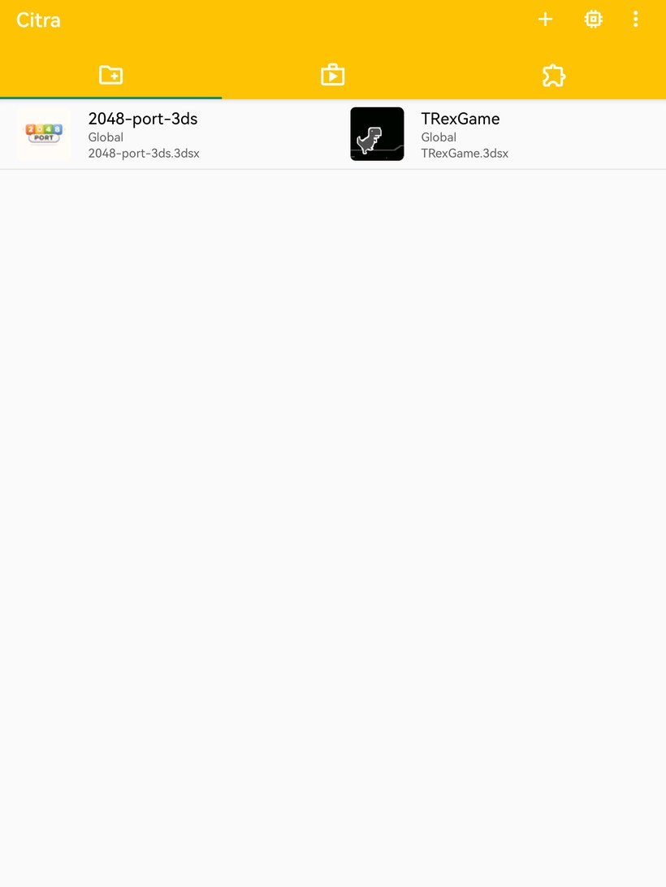
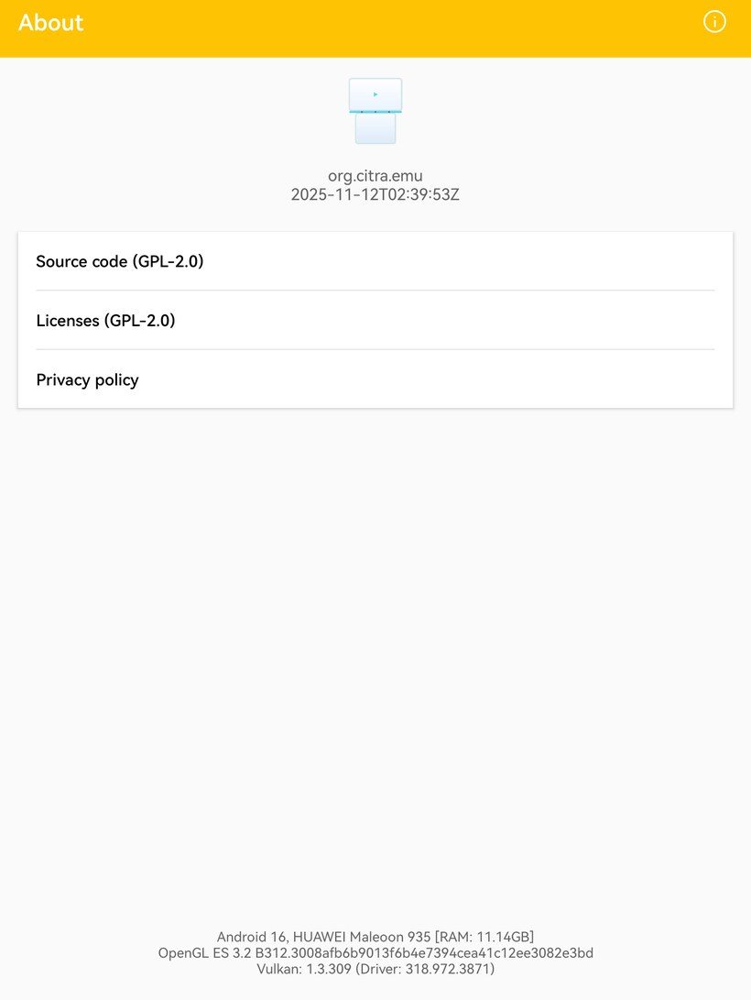

# Ctria Hope

**面向折叠屏的 Citra 3DS 模拟器构建，为 HUAWEI Pura X Max 定制。**

<p align="center">
  
  
</p>

Ctria Hope 把折叠屏手机的内屏变成一台掌机：上屏按 3DS 原生 5:3 比例落在屏幕上半部，
下屏与整套触控按键落在下半部，整体再套一层程序化渲染的机身面板，让设备看起来是一台掌机，
而不是"一台正在跑模拟器的手机"。

**模拟核心未做任何改动。** 这是一个布局、手感与皮肤工程，构建在
[Citra MMJ](https://github.com/weihuoya/citra) 之上：不改变 3DS 软件的执行方式，
不包含也不下载任何 ROM。

| | |
|---|---|
| 应用版本 | 1.4.0（versionCode 4040） |
| 包名 | `org.citra.emu` |
| 底座 | Citra MMJ `3eb22034a`（GPL-2.0） |
| minSdk / targetSdk | 24 / 34 |
| 已验证机型 | HUAWEI Pura X Max（`HOP-LX9`），EMUI 16 / AOSP 16 |
| 许可证 | GPL-2.0-or-later |

---

## 为什么要做这个

原版 Citra MMJ 在 1828×2584 的折叠屏上有三个问题：

1. **3DS 不是全屏设备。** 它有两块屏，其中一块是电阻触摸屏。拉到 1828 px 高之后，
   上屏要么被压成一条细带，要么放大到像素密度毫无意义；触摸屏则落在拇指永远够不到的位置。
2. **转轴是硬边，不是软边。** 画面必须停在折痕**上方**，否则折线会横穿画面中央。
3. **触控按键盖住了游戏。** 默认布局下，按键叠在下屏正中间——正是游戏要点击的位置。

Ctria Hope 用实测数据而不是目测解决这三件事，并加了一层皮肤，让结果看起来是有意设计的。

---

## 改了什么

| 模块 | 作用 | 位置 |
|---|---|---|
| **折叠布局** | 运行时按真实屏幕参数计算上下屏矩形——上屏落在 `28,212,1800,1275`，下屏落在 `410,1380,1402,2124`（992×744），两侧各留 366 px 空白，画面距折痕留 58 px 静默区 | `patch/HingeHelper.java` |
| **壁纸取色主题** | 采样用户壁纸，过滤低饱和与近黑近白像素，求 HSL 调色板，重新上色设置页与所有游戏内弹窗 | `patch/SettingsSkin.java` |
| **8 套机身皮肤** | 整机外观——转轴、屏框、按键凹槽、摄像头条、扬声器格栅、`Fun in Hope` 丝印——全部由代码渲染，没有手绘图 | `patch/skins_design.py`、`patch/skins_panel.py` |
| **标定过的按键布局** | 每个按键的位置/尺寸用洋红描边法在真机上量出来，再写进 `input-layout.ini` | `patch/input-layout.ini` |
| **首启自动配置** | 首次启动创建 `citra-emu/Games`、释放内置游戏与 8 套主题、落盘标定好的按键布局——且必须同步完成，早于原生层扫描 | `patch/BundledGames.java` |
| **存储权限闸门** | `targetSdk 34` 下公开存储被静默封锁；应用改为首启申请"所有文件访问"，跳系统页，回来后自我重建 | `patch/StorageGate.java` |
| **GPL 合规** | 四份许可文件随 APK 分发；关于页改为指向本仓库、许可目录与发布页，替换掉已失效的上游链接 | `patch/gen_licenses.py`、`patch/patch_about.py` |
| **上架合规** | 移除应用内更新检查（AppGallery 审核指南 §3.9 明确禁止）、隐私政策应用内离线可读、许可应用内阅读、自有应用名与图标、去掉 `isGame` 标记 | `patch/AgCompliance.java`、`patch/gen_privacy.py`、`patch/gen_icons.py` |

布局常量、标定方法与踩过的坑见 [`docs/LAYOUT.md`](docs/LAYOUT.md) 与
[`docs/BUILD.md`](docs/BUILD.md)。

**怎么加游戏** —— 支持哪些格式、文件放哪、密钥与系统字体是干什么的、以及真机实测能跑
的六个游戏，见 [`docs/GAMES.zh-CN.md`](docs/GAMES.zh-CN.md)（另有
[English](docs/GAMES.md) / [Русский](docs/GAMES.ru.md)）。

---

## 目录结构

```
patch/          Java 补丁、smali 注入脚本、build.sh、布局 ini
src_overlay/    InputOverlay 原始源码（桩的来源）
themes/         8 套面板主题，可直接放进 citra-emu/theme
free-games/     两个 MIT 开源自制游戏（上游原始构建，未修改）
licenses/       GPL-2.0 全文 + 随包第三方许可
docs/           构建指南、布局标定、游戏导入指南、截图
```

---

## 安装

1. 从 [Releases](../../releases/latest) 下载 APK。
2. 侧载安装（`adb install -r ctria-hope-<版本>.apk`，或拷到手机点击安装）。
3. **首次启动务必授予"所有文件访问"权限**。这不是可选项：Android 11+ 会向无此权限的应用
   隐藏 `citra-emu/`，模拟器读不到自己的游戏目录、主题和配置。
4. 自己的 `.3dsx` / `.3ds` / `.cia` 放进 `citra-emu/Games`。里面已经有两个开源游戏，列表不会是空的。
5. **加密的商业游戏需要你自己提供密钥**：包里不附带密钥表、系统字体、NAND 或 DSP 固件
   （见 [`DISCLAIMER.zh-CN.md`](DISCLAIMER.zh-CN.md)）。从你自己主机提取的文件放进
   `citra-emu/sysdata/`：`aes_keys.txt` 用于解密，`cbf_std.bcfnt` 用于文字显示。
   开源游戏与未加密的游戏（随包那两个）都不需要这两个文件。

> 签名说明：本构建使用自签名证书，无法覆盖安装官方 Citra MMJ，请先卸载原版
> （卸载不会删除 `citra-emu/` 数据目录）。

---

## 按键

触控层针对 Pura X Max 内屏竖屏标定，坐标是**整数百分比**，原点在水平中线。
换机型重标方法见 [`docs/LAYOUT.md`](docs/LAYOUT.md)。

| 元件 | 竖屏位置 |
|---|---|
| L / R 肩键 | 左右边缘 y=1447，与机身肩部凹槽对齐 |
| 十字键 | 左侧，350 px |
| 摇杆 | 左侧十字键下方，281 px |
| X / Y / A / B | 右侧菱形，各 126 px |
| HOME / SELECT / START | 底部居中，位于丝印上方 |

外接键盘或蓝牙手柄仍然可用，并会覆盖触控层。

---

## 主题

8 套皮肤随 APK 分发，首启解压到 `citra-emu/theme/`：`aqua-blue`、`coral-pink`、
`cosmo-black`、`flare-red`、`galaxy`、`ice-white`、`metallic-blue`、`snes`。

全部可从源码重绘——`patch/skins_design.py` 是调色板表（每套 6 个颜色），
`patch/skins_panel.py` 画出一套 39 个文件：

```bash
cd patch && python3 gen_theme.py      # 输出 ../themes/*.zip
adb push themes/*.zip /sdcard/citra-emu/theme/
```

改配色**不需要**重新打包 APK。

---

## 内置开源游戏

随包两个游戏，保证装完不是空列表。均为上游原始构建，MIT 许可，全文在 `licenses/`：

| 游戏 | 文件 | 上游 |
|---|---|---|
| T-Rex Game 3DS | `TRexGame.3dsx` | [BlyZeDev/T-Rex-Game-3DS](https://github.com/BlyZeDev/T-Rex-Game-3DS) |
| 2048 for 3DS | `2048-port-3ds.3dsx` | [0rientd/2048-port-3ds](https://github.com/0rientd/2048-port-3ds) |

---

## 从源码构建

完整依赖与步骤：[`docs/BUILD.md`](docs/BUILD.md)。

```bash
# 工作目录需含 dec/（上游 APK 的 apktool 反编译树）
export JAVA_HOME=/path/to/jdk-17
export ANDROID_HOME=/path/to/android-sdk
bash patch/build.sh          # -> ./citra-hinge.apk
```

流水线：`javac` → `d8` → 十个幂等注入脚本 → `apktool b` → 追加 `classes2.dex` →
`zipalign` → `apksigner`。每个注入脚本都可重复执行，会先删掉自己上一次的块。

---

## 法律

- **许可**：GPL-2.0-or-later，承自 Citra。全文见 [`LICENSE`](LICENSE)。
  每个已发布二进制的对应源码即本仓库——上游 commit 与底座 APK 哈希见 [`NOTICE.md`](NOTICE.md)。
- **隐私**：[`PRIVACY.zh-CN.md`](PRIVACY.zh-CN.md) —— 无统计、无广告、无账号、无埋点。
- **声明**：[`DISCLAIMER.zh-CN.md`](DISCLAIMER.zh-CN.md) —— 与任天堂无关，不含 ROM、
  不含系统文件、不含密钥。
- **命名**："Ctria Hope" 是本分支自有名称与美术；除继承的代码外，与 Citra 项目无隶属关系。

---

## 致谢

- [Citra Emulator Project](https://github.com/citra-emu/citra) —— 模拟器本体，GPL-2.0
- [weihuoya/citra](https://github.com/weihuoya/citra)（Citra MMJ）—— 本项目的 Android 底座
- BlyZeDev、0rientd —— 随包开源游戏
- 本仓库中的面板美术、布局引擎、主题与工具链 —— Ctria Hope 作者，GPL-2.0

---

*English: [README.md](README.md)*
